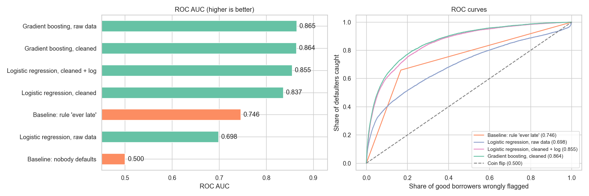
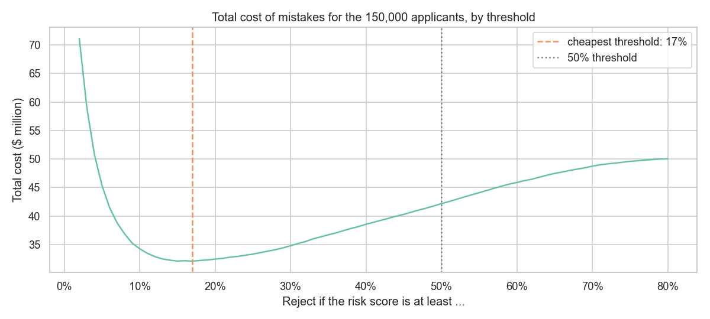
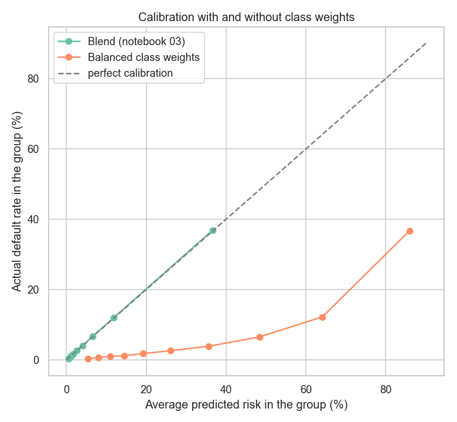
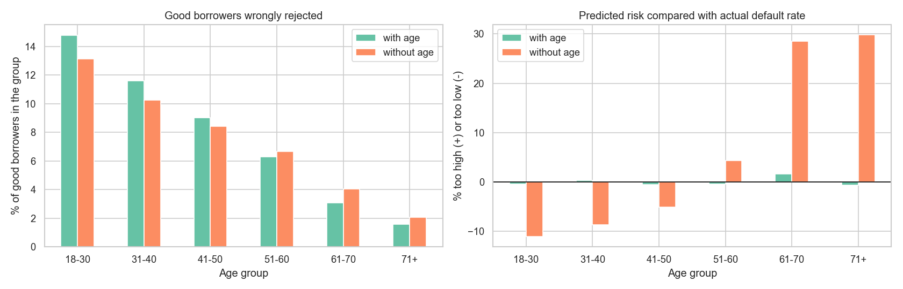

# Credit Risk Prediction

Predicting which borrowers will get into serious financial trouble within two years, and turning the risk score into a lending decision, using the [Kaggle "Give Me Some Credit" competition](https://www.kaggle.com/c/GiveMeSomeCredit) (150,000 borrowers).

> A gradient boosting blend reaches **ROC AUC 0.866** (Kaggle private score 0.8675 for the first model), with well-calibrated probabilities, plain-language reasons for every decision, and an analysis of how the model treats different age groups.



## Notebooks

| Notebook | What it covers |
|---|---|
| [01_exploration](notebooks/01_exploration.ipynb) | A rare target (6.7%), sanity checks for copies, special codes, outliers, a column with two meanings, what predicts trouble |
| [02_first_model](notebooks/02_first_model.ipynb) | Baselines, logistic regression vs. gradient boosting, the effect of cleaning, choosing a decision threshold from the costs of mistakes, first Kaggle submission |
| [03_tuning_and_blending](notebooks/03_tuning_and_blending.ipynb) | Tuning, XGBoost, blending, and a fold-by-fold check of whether tiny gains are real |
| [04_calibration](notebooks/04_calibration.ipynb) | Are the risk scores real probabilities? How class weights break them, how to repair them, planning for losses |
| [05_explanation_and_fairness](notebooks/05_explanation_and_fairness.ipynb) | SHAP, reasons for a rejection, how the model treats age groups, what happens without age |

## Key findings so far

- **Past behaviour predicts future behaviour.** Borrowers never late in the last two years default at 2.8%; those late at least once at 22%.
- **The data has traps.** Late-payment counts of 96 and 98 are codes, not counts. Credit utilisation reaches 50,708 times the limit. `DebtRatio` is a ratio when the income is known, but a dollar amount when it is missing.
- **Cleaning was worth 0.15 AUC for logistic regression** (0.70 → 0.855) and nothing for gradient boosting. Linear models need clean data; tree models mostly do not.

| Model (5-fold cross-validation) | ROC AUC |
|---|---|
| Rule: "late at least once" | 0.746 |
| Logistic regression, raw data | 0.698 |
| Logistic regression, cleaned + log | 0.855 |
| **Gradient boosting, cleaned** | **0.864** |

- **The threshold is a business decision.** With illustrative costs (a missed defaulter costs 5 times as much as a rejected good borrower), the cheapest rule is to reject applicants above 17% risk, not 50%. It catches 56% of defaulters instead of 18%, and cuts the cost of mistakes by about a quarter.



| Kaggle submission | Model | CV ROC AUC | Public | Private |
|---|---|---|---|---|
| v1 | Gradient boosting, cleaned features | 0.8644 | 0.86024 | 0.86752 |
| v2 | Blend of tuned gradient boosting and XGBoost | 0.8664 | _to be added_ | _to be added_ |

## Tuning, calibration and fairness

**Tuning and blending add little.** Tuned XGBoost and a blend of two boosting models reach 0.8664 (from 0.8644). The gain is tiny but consistent: the blend is at least as good as the first model in all five folds. Adding logistic regression to the blend makes it worse.

**The probabilities are honest.** When the blend says 10% risk, about 10% default. A popular trick for rare events, `class_weight="balanced"`, leaves the AUC unchanged but makes the average predicted risk 32% instead of 6.7%. Used with the 17% rule, it would raise the cost of mistakes from $32 million to $82 million. Recalibration repairs it.



**Every decision can be explained.** SHAP gives a rejected applicant the main reasons, for example: *late payments in the last two years; payments 90 days or more late; high use of available credit.*

**Age is a fairness trade-off.** The model's probabilities are accurate for every age group, but a good borrower aged 18–30 is about nine times as likely to be wrongly rejected as one over 70. Removing age costs little (AUC 0.866 → 0.863) but does not close the gap, and it makes the model overestimate older applicants' risk by up to about 30%. Choosing which kind of fairness matters is a decision for people, not for the model.



## Project structure

```
├── data/                  # Kaggle files (not committed – see below)
├── images/                # Charts saved by the notebooks
├── notebooks/             # Numbered notebooks, run in order
├── src/
│   └── features.py        # CreditFeatures: the cleaning decisions from notebook 01
├── submissions/           # Kaggle prediction files
├── requirements.txt
└── README.md
```

## How to run

1. Download the competition files from [Kaggle](https://www.kaggle.com/c/GiveMeSomeCredit/data) into the `data/` folder (`cs-training.csv`, `cs-test.csv`).
2. Install the dependencies:
   ```bash
   pip install -r requirements.txt
   ```
3. Open the notebooks in `notebooks/` in VS Code or Jupyter and run them in order.

## Tools

Python · pandas · NumPy · Matplotlib · seaborn · scikit-learn · XGBoost · SHAP · Jupyter
